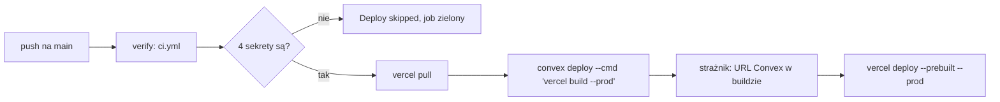

# Wdrożenie: Convex i Vercel

Backend (Convex) i frontend (Vercel) wdraża jeden workflow: `.github/workflows/deploy.yml`. Uruchamia się po każdym pushu na `main` (czyli po scaleniu PR) oraz ręcznie przez `workflow_dispatch`. Najpierw woła ten sam `ci.yml` co PR (job `verify`), a dopiero potem wdraża.

> Starter jest zielony, zanim ktokolwiek założy konta. Bez sekretów job `deploy` kończy się sukcesem i pisze w podsumowaniu „Deploy skipped” z listą brakujących sekretów. Nic się wtedy nie wdraża.

## Jak to działa

Kroki workflow po sprawdzeniu sekretów:

1. `npx vercel pull --yes --environment=production` pobiera konfigurację projektu.
2. `npx convex deploy --cmd "npx vercel build --prod" --cmd-url-env-var-name VITE_CONVEX_URL` wdraża funkcje Convex i uruchamia build Vercela z `VITE_CONVEX_URL` ustawionym na adres produkcyjnego deploymentu ([Convex: Using Convex with Vercel](https://docs.convex.dev/production/hosting/vercel), [Convex CLI](https://docs.convex.dev/cli)).
3. Strażnik wyciąga nazwę deploymentu z klucza `CONVEX_DEPLOY_KEY` i szuka `<nazwa>.convex.cloud` w `.vercel/output/static`. Brak trafienia kończy job błędem. Dokumentacja nie opisuje, czy wstrzyknięty `VITE_CONVEX_URL` wygrywa z wartością pobraną przez `vercel pull`, więc workflow sprawdza wynik zamiast wierzyć, że zadziałało.
4. `npx vercel deploy --prebuilt --prod` wysyła gotowy build ([Vercel: GitHub Actions](https://vercel.com/kb/guide/how-can-i-use-github-actions-with-vercel)).

Sekrety trafiają tylko do kroków, które ich potrzebują (każdy krok ma własny blok `env`), a wersje narzędzi (`vercel@65.16.0`) i akcji są przypięte.

## Lista na pierwsze wdrożenie

### 1. Convex: projekt produkcyjny i klucz

1. Zaloguj się: `npx convex login`, utwórz projekt (np. przez `npx convex dev`, który zapisze `CONVEX_DEPLOYMENT` w `.env.local`).
2. W [panelu Convex](https://dashboard.convex.dev/) otwórz deployment **produkcyjny**, wejdź na stronę _Deployment Settings_, kartę _General_, i kliknij _Generate Production Deploy Key_. Przy ustawianiu uprawnień klucza włącz `deployment:deploy` ([Convex: Using Convex with Vercel](https://docs.convex.dev/production/hosting/vercel)).
3. Klucz ma postać `prod:<nazwa-deploymentu>|<token>`. Użyj klucza produkcyjnego, nie deweloperskiego: `convex deploy` z kluczem deweloperskim wdroży funkcje na deployment deweloperski, a nie na produkcję, więc front dostałby adres złego backendu.
4. Ustaw zmienne backendu na deploymentcie produkcyjnym (nie ma ich w `.env.local` ani w GitHubie): `npx convex env set AI_PROVIDER mock --prod`. Pełna lista i ścieżki dostawców: [ai-providers.md](ai-providers.md). `mock` jest bezpieczną wartością domyślną na demo.

### 2. Vercel: projekt i trzy identyfikatory

1. Załóż projekt w Vercel z tego repozytorium (framework Vite; `vercel.json` jest w repo) albo utwórz go z CLI.
2. W katalogu repozytorium: `npx vercel link`. Powstaje `.vercel/project.json` z `orgId` i `projectId` (katalog `.vercel` jest ignorowany przez Git).
3. `orgId` to `VERCEL_ORG_ID`, `projectId` to `VERCEL_PROJECT_ID`. Token (`VERCEL_TOKEN`) tworzysz w ustawieniach konta Vercel.
4. **Nie ustawiaj `VITE_CONVEX_URL` w zmiennych projektu Vercel.** Wartość wstrzykuje `npx convex deploy` przy buildzie. Zmienna w projekcie mogłaby ją przykryć i zbudować front przeciw złemu backendowi (dokładnie przed tym chroni strażnik).
5. `vercel.json` ma `"git": { "deploymentEnabled": false }`, więc integracja Vercela z GitHubem nie wdraża drugi raz. Zostaje tylko wdrożenie z Actions.

### 3. GitHub: środowisko `production` i sekrety

Utwórz środowisko `production` (Settings > Environments) i dodaj w nim cztery sekrety:

| Sekret              | Skąd                                    | Wartość                 |
| ------------------- | --------------------------------------- | ----------------------- |
| `CONVEX_DEPLOY_KEY` | Convex, Production deploy key           | `prod:<nazwa>\|<token>` |
| `VERCEL_TOKEN`      | Vercel, ustawienia konta, Tokens        | token                   |
| `VERCEL_ORG_ID`     | `.vercel/project.json` po `vercel link` | `orgId`                 |
| `VERCEL_PROJECT_ID` | `.vercel/project.json` po `vercel link` | `projectId`             |

Opcjonalnie dojdzie piąty, `SENTRY_AUTH_TOKEN`, oraz zmienne `SENTRY_ORG` i `SENTRY_PROJECT` (sekcja o Sentry niżej).

Sekrety dodane do środowiska widzi tylko job z `environment: production`, czyli `deploy`. Gdy ustawisz je na poziomie repozytorium, też zadziałają. Środowisko pozwala dodać reguły ochronne (np. zatwierdzenie wdrożenia), ale patrz ograniczenia planów niżej.

### 4. Pierwszy deploy

1. Scal PR do `main` albo uruchom workflow ręcznie: Actions > Deploy > Run workflow.
2. W logu jobu `deploy` sprawdź, że krok „Verify build targets the production Convex deployment” pokazał `Found <nazwa>.convex.cloud in build output`.
3. Otwórz adres z Vercela i sprawdź, że baner „Tryb offline” się **nie** pojawia. Jeśli się pojawia, front zbudował się bez `VITE_CONVEX_URL`.

## Plany darmowe: co działa, a co nie

Starter ma działać na darmowych planach. Trzeba znać ich granice, bo część zabezpieczeń z tego dokumentu ich wymaga:

- **Środowiska GitHuba i ochrona gałęzi** na planie Free są dostępne tylko w **publicznych** repozytoriach ([Environments](https://docs.github.com/en/actions/managing-workflow-runs-and-deployments/managing-deployments/managing-environments-for-deployment), [Protected branches](https://docs.github.com/en/repositories/configuring-branches-and-merges-in-your-repository/managing-protected-branches/about-protected-branches)). W repozytorium prywatnym na Free `environment: production` nadal się wykona, ale nie dostaniesz reguł ochronnych, a sekrety środowiska mogą być niedostępne. W takim razie trzymaj sekrety na poziomie repozytorium.
- **Merge queue** wymaga repozytorium należącego do **organizacji** (na Free: publicznego) ([Managing a merge queue](https://docs.github.com/en/repositories/configuring-branches-and-merges-in-your-repository/configuring-pull-request-merges/managing-a-merge-queue)). W repozytorium osobistym kolejki nie włączysz.
- **Vercel Hobby** jest przeznaczony do użytku niekomercyjnego i nie ma współpracy zespołowej ([Hobby plan](https://vercel.com/docs/plans/hobby)). Integracja Git na Hobby nie wdraża prywatnych repozytoriów organizacji. Dlatego wdrażamy przez CLI z Actions, a wdrożenia z Gita są wyłączone w `vercel.json`. **Wdrożenie przez CLI z repozytorium organizacji na Hobby nie zostało jeszcze zweryfikowane.** Jeśli Vercel je odrzuci, potrzebny będzie plan Pro albo repozytorium na koncie osobistym.

## Ochrona gałęzi `main`

Settings > Branches (albo Rulesets) > reguła dla `main`. Ustawienia dokładnie takie:

- wymagany PR (bez wymaganej liczby zatwierdzeń, bo zespół jest mały);
- wymagany check **`gate`**, i tylko on. `gate` zbiera wyniki `verify`, `secrets` i `hot-files`, a działa też na `merge_group`, więc kolejka go widzi;
- **wymagana merge queue**;
- scalanie wyłącznie przez **squash**;
- zakaz force push;
- reguła dla **dokładnej** nazwy `main`, bez wildcardu. Merge queue nie działa z regułą wzorcową ([dokumentacja](https://docs.github.com/en/repositories/configuring-branches-and-merges-in-your-repository/configuring-pull-request-merges/managing-a-merge-queue)).

Jeśli `gate` nie pojawia się na liście checków, workflow `ci.yml` musiał zadziałać co najmniej raz na PR. Check, który „wisi” jako Expected, zwykle oznacza literówkę w nazwie albo brak triggera `merge_group`.

Ograniczenia planów (wyżej) dotyczą także tej sekcji: bez publicznego repozytorium albo organizacji reguły ochronne i kolejka są niedostępne, a dyscyplinę trzeba utrzymać umową w zespole ([CONTRIBUTING.md](../CONTRIBUTING.md)).

## Podglądy Vercel (preview) są wyłączone

Przy `deploymentEnabled: false` żaden PR nie dostaje podglądu. Jeśli zespół ich potrzebuje:

1. W panelu Convex otwórz stronę _Settings_ **projektu** (nie deploymentu) i kliknij _Generate Preview Deploy Key_. W Vercel dodaj w _Environment Variables_ zmienną `CONVEX_DEPLOY_KEY` z tym kluczem i w polu _Environment_ odznacz wszystko poza _Preview_ ([Convex: Using Convex with Vercel](https://docs.convex.dev/production/hosting/vercel)). Klucz produkcyjny w Preview oznaczałby, że każdy PR wdraża na produkcyjny backend.
2. W Vercel (_Settings > Build & Development settings > Build Command_) ustaw komendę builda `npx convex deploy --cmd 'npm run build'`, żeby każdy podgląd dostał własny deployment Convex.
3. Usuń `"git": { "deploymentEnabled": false }` z `vercel.json`. Ten plik jest wspólny (hot file), więc zmiana idzie osobnym małym PR-em uzgodnionym z zespołem. Po tej zmianie Vercel zacznie też wdrażać `main` z Gita, drugi raz obok workflow, więc ustal, które z dwóch wdrożeń zostaje.

Nie ustawiaj `VITE_CONVEX_URL` w Vercelu także tutaj.

## Sentry (opcjonalnie)

Front ma wbudowaną, ale wyłączoną domyślnie obsługę Sentry (`@sentry/react`, kod w `src/lib/sentry.ts`). Bez `VITE_SENTRY_DSN` biblioteka nie jest nawet pobierana: ładuje się dynamicznym `import()` dopiero wtedy, gdy adres jest ustawiony, więc domyślna paczka się nie powiększa. Testy e2e i CI nie mają DSN-a i nie powinny go mieć.

### Włączenie we froncie

1. W Sentry utwórz projekt (platforma React) i skopiuj jego DSN.
2. `VITE_SENTRY_DSN`: wpisz DSN lokalnie w `.env.local` albo, dla produkcji, w zmiennych projektu Vercel (środowisko Production). To nie jest sekret, trafia do paczki frontu. Pusta wartość wyłącza Sentry.
3. Środowisko w Sentry to tryb Vite (`production` na Vercelu), a release to SHA commita: workflow `deploy.yml` ustawia `VITE_COMMIT_SHA` w kroku buildu.

### Mapy źródłowe (opcjonalnie)

Dzięki nim stack trace w Sentry pokazuje kod źródłowy zamiast zminifikowanego. Wtyczka `@sentry/vite-plugin` działa tylko wtedy, gdy podczas buildu jest ustawiony `SENTRY_AUTH_TOKEN`. Bez niego `vite.config.ts` zachowuje się dokładnie jak wcześniej.

| Nazwa               | Rodzaj          | Wartość                                           |
| ------------------- | --------------- | ------------------------------------------------- |
| `SENTRY_AUTH_TOKEN` | sekret GitHuba  | token organizacji z uprawnieniem do wgrywania map |
| `SENTRY_ORG`        | zmienna GitHuba | slug organizacji w Sentry                         |
| `SENTRY_PROJECT`    | zmienna GitHuba | slug projektu w Sentry                            |

Sekret dodajesz tam, gdzie pozostałe (sekcja 3), a zmienne w _Settings > Secrets and variables > Actions > Variables_. Token dostaje wyłącznie krok buildu w `deploy.yml`. Po wysłaniu pliki `*.map` są usuwane z `dist`, więc nie trafiają na Vercel i nikt ich nie pobierze z publicznego adresu.

### Co jest wycinane przed wysyłką

Hook `beforeSend` (i `beforeBreadcrumb`) usuwa z każdego zdarzenia:

- ciała żądań i ciasteczka;
- wartości pod kluczami pasującymi do `prompt`, `apiKey`, `token`, `authorization`, `password`, `secret`, `cookie`, `credential` oraz do `ai` jako osobnego członu nazwy (`ai`, `aiResponse`, `AI_API_KEY`; `email` czy `detail` zostają);
- wartości takich parametrów w adresach URL i zapytaniach, także we fragmencie po `#`;
- wszystkie breadcrumbs z konsoli, bo logi mogą zawierać prompty albo odpowiedzi modelu.

Zasady są pokryte testami w `src/lib/sentry.test.ts`. Jeśli dodajesz do zdarzeń własne dane (`Sentry.setContext` i podobne), trzymaj je pod kluczami, które filtr rozpoznaje, albo rozszerz wyrażenie w `sentry.ts`.

### Backend (Convex)

Backend nie wymaga zmian w kodzie. Convex ma własną integrację z Sentry, ale **tylko w planie Pro**: w panelu otwórz _Deployment Settings > Integrations_, wybierz kartę Sentry i podaj DSN osobnego projektu Sentry z platformą **Node.js**. Convex dodaje do zdarzeń tagi `func`, `func_type`, `func_runtime`, `request_id`, `server_name` i `environment` ([Convex: Exception reporting](https://docs.convex.dev/production/integrations/exception-reporting)). Filtr z frontu tu nie działa, więc w akcjach AI nie wkładaj promptów do komunikatów błędów.

## Kontenery i GHCR (później)

Starter nie używa Dockera: Vercel buduje front, a Convex hostuje backend. Gdyby później pojawiła się usługa wymagająca kontenera (np. własny serwer modelu albo worker), obraz dałoby się publikować w GitHub Container Registry. Wystarczy osobny workflow z uprawnieniem `packages: write`, logowaniem do `ghcr.io` tokenem `GITHUB_TOKEN` i krokiem `docker build` oraz `docker push`, uruchamiany po zielonym `verify`. Do tego czasu nic z tego nie jest potrzebne i niczego nie dodajemy na zapas.

## Zobacz też

- [troubleshooting.md](troubleshooting.md): typowe błędy.
- [ai-providers.md](ai-providers.md): zmienne Convex dla dostawców AI.
- [github-issues-workflow.md](github-issues-workflow.md): gałęzie, PR-y i kolejka scalania.
